# Sigenergy Flow Card

A standalone Home Assistant Lovelace card that recreates the SigenCloud / mySigen power-flow dashboard for a Sigenergy installation (solar, SigenStor battery, Sigen Gateway, grid, and optional AC/DC EV chargers).

- Animated power flow between the solar panels, SigenStor, gateway, home and grid, drawn over a photo of the house. Each highlight moves in the direction power is flowing, faster at higher power, and stops when idle.
- Day and night looks: a light theme with the daytime photo between sunrise and sunset, a dark theme with the night photo otherwise. Force either with the `style` option.
- Power readings for solar, home, SigenStor (with battery state of charge), grid, and the AC and DC chargers when present.
- Today's energy statistics and a battery level panel. Tap any statistic or the battery level to open that sensor's details and history, or the stored energy (e.g. 4.4 of 40.3 kWh) for a chart of the energy held in the battery today.
- Power metrics chart from midnight to now, with sunrise and sunset times for your Home Assistant location. Hover (or tap) the chart to see every value at that time.
- Tap **SOLAR** for per-string PV details (voltage, current, power, today's and lifetime production) and a chart of each string's power today.
- Tap **HOME** for a live breakdown of power usage across the entities you list, sorted from highest to lowest.
- Tap **DC CHARGER** to adjust the DC charger's maximum charging power.

No other custom cards (button-card, card-mod, Mushroom) are needed.

## Screenshots

The screenshots show the day style; [Night](#night) shows the dark one.

### Desktop

Main view, with the power metrics overlay shown by hovering over the chart:

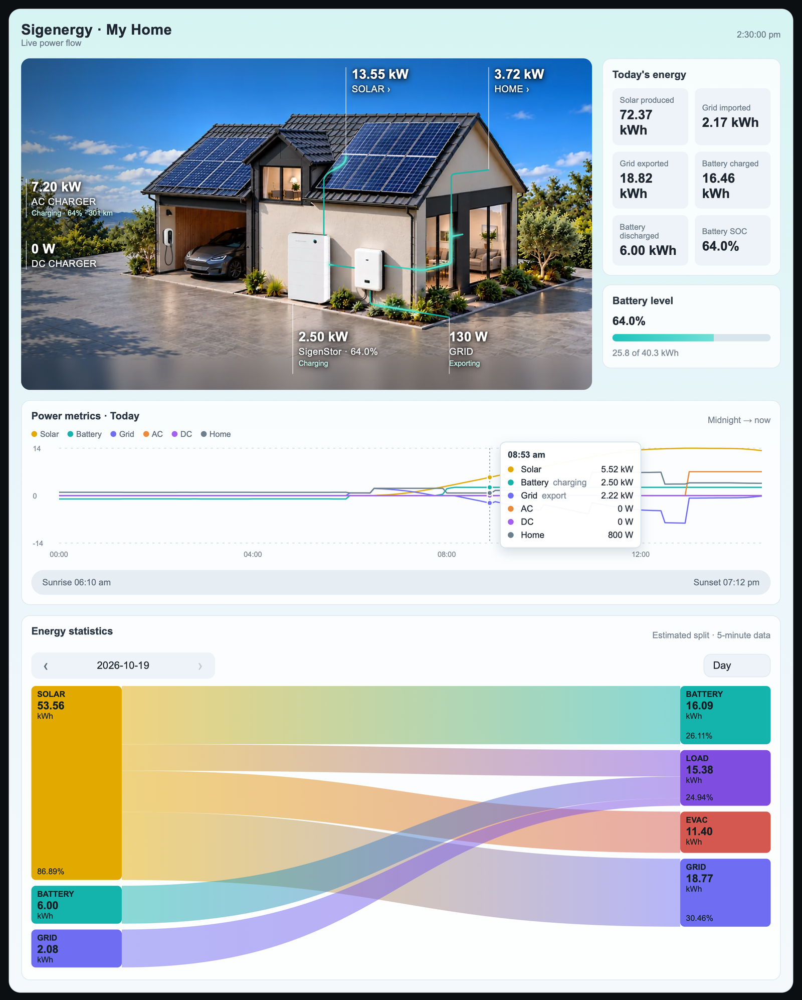

Tapping **SOLAR**:

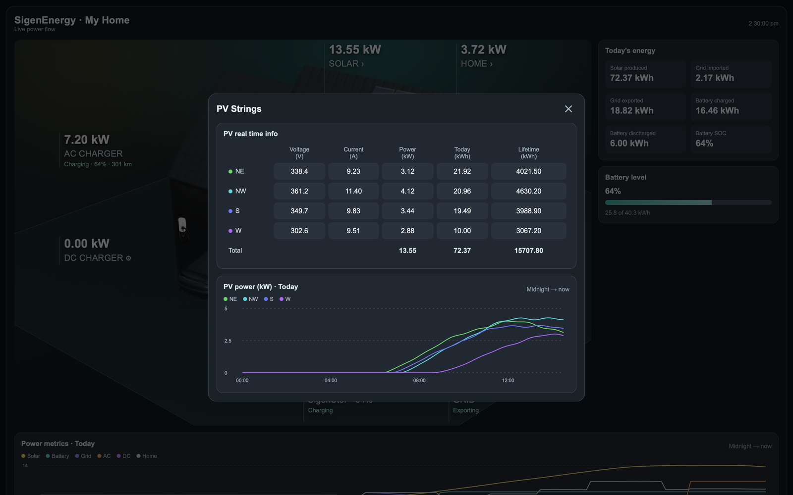

Tapping **HOME**:

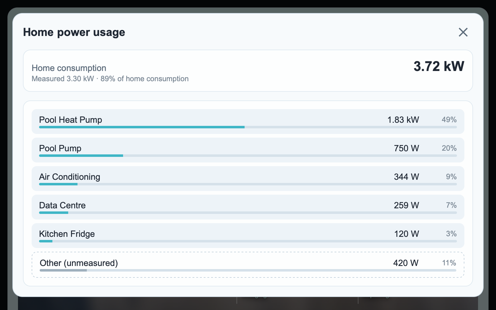

Tapping the stored energy under **Battery level**:

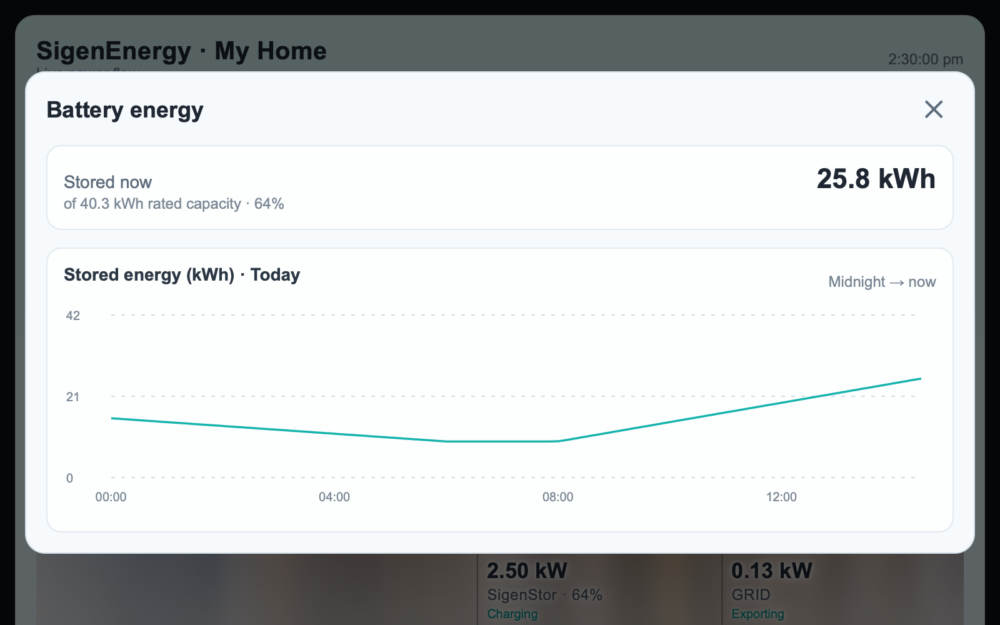

### iPhone (portrait)

<table>
  <tr>
    <th>Main view</th>
    <th>SOLAR</th>
    <th>HOME</th>
    <th>Battery energy</th>
  </tr>
  <tr>
    <td>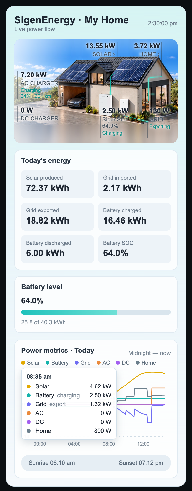</td>
    <td valign="top">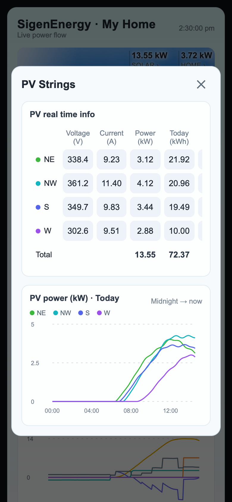</td>
    <td valign="top">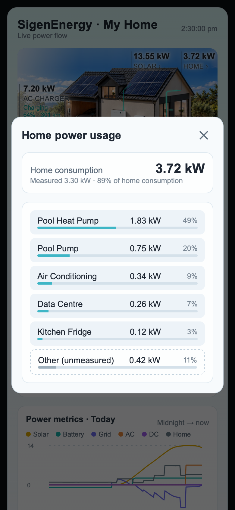</td>
    <td valign="top">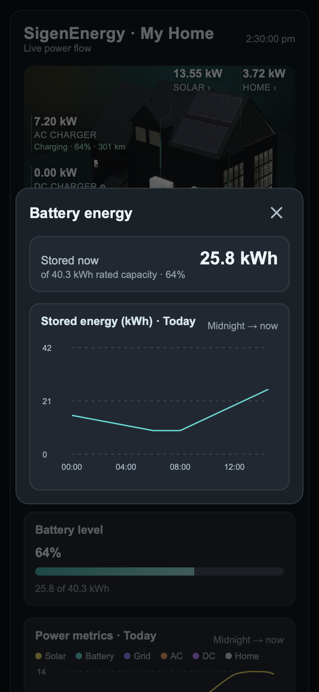</td>
  </tr>
</table>

### Night

Between sunset and sunrise (or with `style: night`) the card switches to the dark theme and the night photo:

<table>
  <tr>
    <th>Desktop</th>
    <th>iPhone (portrait)</th>
  </tr>
  <tr>
    <td valign="top">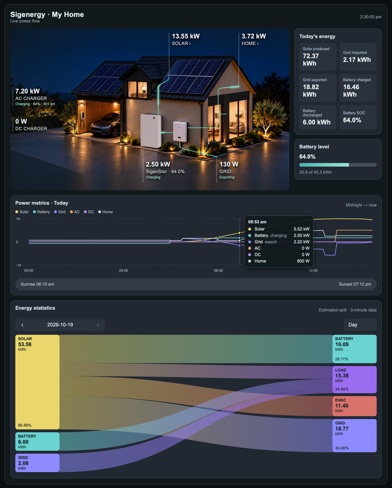</td>
    <td valign="top">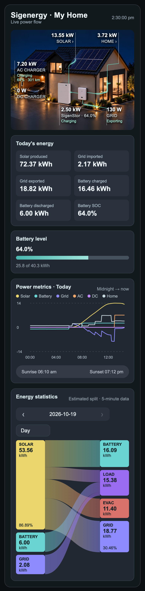</td>
  </tr>
</table>

### Energy statistics

The Energy statistics panel, with a source selected (SOLAR, desktop day) and a consumer selected (LOAD, desktop night); on a phone it fits the width (day with GRID selected, and night with nothing selected):

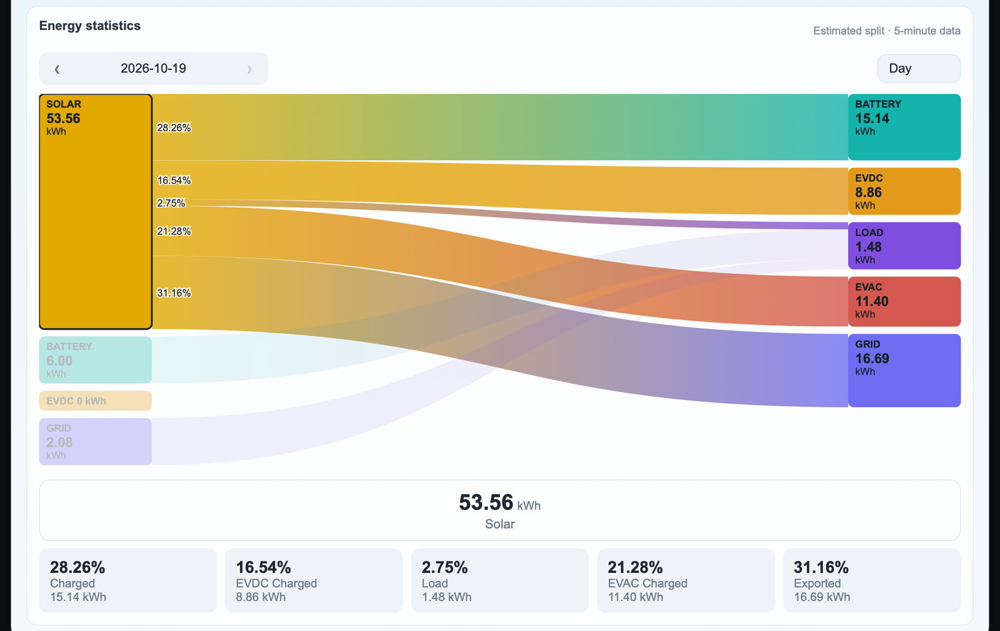

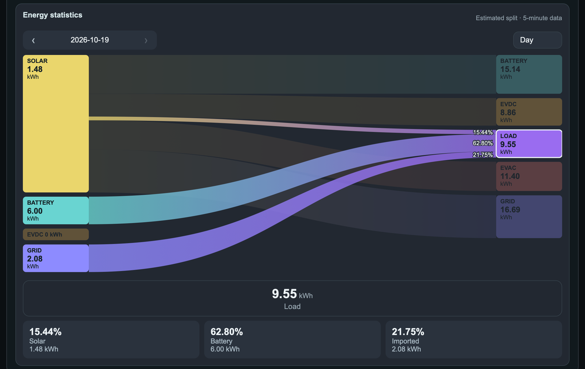

<table>
  <tr>
    <th>Day, GRID selected</th>
    <th>Night</th>
  </tr>
  <tr>
    <td valign="top">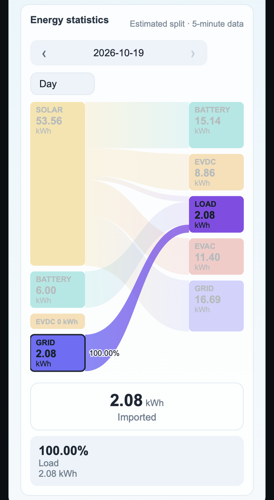</td>
    <td valign="top">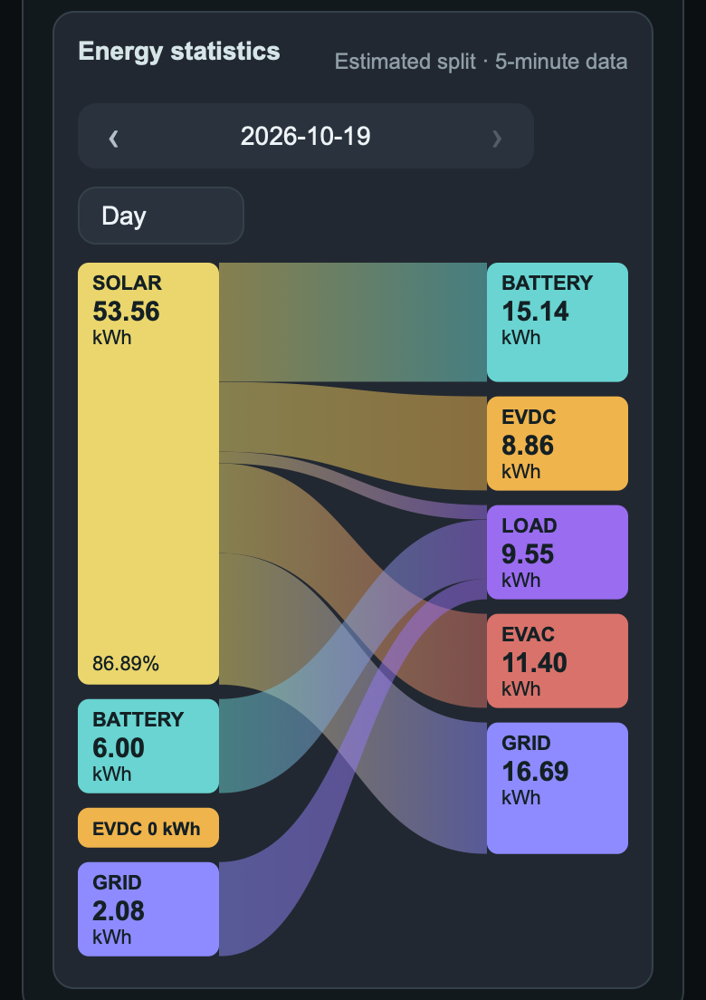</td>
  </tr>
</table>

## Requirements

All data is read locally over Modbus by the [Sigenergy Local Modbus](https://github.com/TypQxQ/Sigenergy-Local-Modbus) integration, which installs through HACS ([open it in HACS](https://my.home-assistant.io/redirect/hacs_repository/?owner=TypQxQ&repository=Sigenergy-Local-Modbus&category=integration)). Install and configure it first; the card uses its default entity IDs (`sensor.sigen_plant_*`, `sensor.sigen_inverter_*`, `sensor.sigen_ac_charger_*`).

## Installation

The artwork is built into `sigenergy-flow-card.js`, so the card is a single file: nothing needs copying to `/config/www/Sigenergy/`.

### HACS (recommended)

1. In Home Assistant, open **HACS**, then **⋮ → Custom repositories**.
2. Add `https://github.com/jyavenard/Sigenergy_Card` with type **Dashboard**.
3. Search HACS for **Sigenergy Flow Card**, open it and select **Download**.
4. Reload the browser when HACS asks. HACS registers the dashboard resource (`/hacsfiles/Sigenergy_Card/sigenergy-flow-card.js`) for you.
5. Add the card to a dashboard (**Edit dashboard → Add card → Manual**):

   ```yaml
   type: custom:sigenergy-flow-card
   ```

HACS offers an update whenever a new release is published on GitHub (see [CHANGELOG.md](CHANGELOG.md)); download it and reload the browser.

If your dashboards are configured in YAML mode, HACS cannot register the resource; add it yourself as below, with the URL `/hacsfiles/Sigenergy_Card/sigenergy-flow-card.js`.

### Manual

1. Copy `sigenergy-flow-card.js` to `/config/www/` on your Home Assistant instance, for example over SSH:

   ```sh
   scp sigenergy-flow-card.js root@homeassistant.local:/config/www/
   ```

2. Register it as a dashboard resource: **Settings → Dashboards → ⋮ → Resources → Add resource**
   - URL: `/local/sigenergy-flow-card.js?v=1`
   - Resource type: **JavaScript module**

3. Add the card to a dashboard as above, then hard-refresh the browser. On the Home Assistant companion app, you may need to reset the app's frontend cache from its settings.

To update, copy the new file over the old one and increase the `?v=` number in the resource URL (for example `?v=2`); the browser keeps using its cached copy until that URL changes.

### Moving from a manual install to HACS

Remove the `/local/sigenergy-flow-card.js` resource and delete `/config/www/sigenergy-flow-card.js`, so only the HACS copy is loaded. The `/config/www/Sigenergy/` artwork directory is no longer used and can be deleted.

## Configuration

All options are optional.

| Option | Default | Description |
| --- | --- | --- |
| `entities` | Sigenergy entities | Replaces the entities the card reads, for other inverter brands or integrations. See [Custom entities](#custom-entities). |
| `battery_power_invert` | `false` | Set `true` if your battery power sensor is positive while **discharging**. The card expects positive while charging. |
| `pv_strings` | `[PV1, PV2, PV3, PV4]` | The PV strings, in order. Each is a display name, or an object with its own entities (see [PV strings](#pv-strings)). The number of entries sets how many strings are shown. |
| `home_entities` | `[]` | Power entities listed when tapping **HOME**. Without it, HOME is a plain label. |
| `ac_charger_soc` | none | Battery level entity of the vehicle on the AC charger. Same as `entities.ac_charger_vehicle_soc`. |
| `ac_charger_range` | none | Range entity of that vehicle. Only shown together with `ac_charger_soc`. Same as `entities.ac_charger_vehicle_range`. |
| `show_lifetime` | `true` | Show the AC charger's energy consumed and the DC charger's lifetime energy charged and discharged. |
| `show_phase_mode` | `false` | Show the phase power mode under **GRID**. |
| `show_energy_statistics` | `true` | Show the **Energy statistics** panel (see [Energy statistics](#energy-statistics)). |
| `debug_energy_statistics` | `false` | List, under the Energy statistics panel, the energy each statistics sensor recorded over the period (to check the sensors against another source). |
| `style` | `auto` | Artwork and theme: `day`, `night` or `auto` (day between sunrise and sunset). |

### Example

```yaml
type: custom:sigenergy-flow-card
pv_strings: [NE, NW, S, W]
ac_charger_soc: sensor.my_car_battery_level
ac_charger_range: sensor.my_car_battery_range
home_entities:
  - entity: sensor.sigen_ac_charger_charging_power
    name: EV
    icon: mdi:car-electric
  - entity: sensor.pool_power
    name: Pool
    icon: mdi:pool
  - sensor.hot_water_power
```

### Style

`style` selects the artwork and theme:

- `auto` (default): day between today's sunrise and sunset (as shown under the chart; `sun.sun` is used if no location is set), night otherwise.
- `day`: always the light theme with the daytime photo.
- `night`: always the dark theme with the night photo.

```yaml
type: custom:sigenergy-flow-card
style: day
```

### Flow animation

Each flow's highlight moves from its source to its destination at `60 + 35 × √kW` scene units per second, using that flow's own power, so a 5 kW flow runs about 1.6 times faster than a 0.6 kW one. A flow below 0.025 kW is idle. The short branch of the home line into the glass doors continues the home flow's animation from the point where it forks, at the same speed. With *reduce motion* enabled in the operating system, the lines are drawn without moving highlights.

### Custom entities

Every entity the card reads can be replaced under `entities:`. For each key:

- **Not set:** the Sigenergy default is used (for the plant/inverter pairs, the plant sensor first, then the inverter fallback).
- **Set to an entity ID:** that entity is used, with no fallback.
- **Set to `false`:** that item is hidden (its tile, line or charger disappears).

Power values can be in W, kW or MW and energy values in Wh, kWh or MWh; the card converts them to kW and kWh using each entity's unit. Power readings are shown in W below 1 kW, in kW up to 1000 kW and in MW above. An unknown key or a value that is not an entity ID shows a configuration error.

| Key | Default | Used for |
| --- | --- | --- |
| `pv_power` | `sensor.sigen_plant_pv_power` | SOLAR value, solar wire, chart |
| `home_power` | `sensor.sigen_plant_consumed_power` | HOME value, home wire, chart, home usage dialog |
| `battery_power` | `sensor.sigen_plant_battery_power`, fallback `sensor.sigen_inverter_battery_power` | Battery value and status, wire, chart. Positive = charging (see `battery_power_invert`). |
| `battery_soc` | `sensor.sigen_plant_battery_state_of_charge`, fallback `sensor.sigen_inverter_battery_state_of_charge` | SOC label, tile, bar and stored-energy history |
| `battery_capacity` | `sensor.sigen_plant_rated_energy_capacity` | Stored energy (SOC × capacity) |
| `grid_import_power` | `sensor.sigen_plant_grid_import_power` | GRID value and status, wire, chart (positive while importing) |
| `grid_export_power` | `sensor.sigen_plant_grid_export_power` | GRID value and status, wire, chart (positive while exporting) |
| `phase_mode` | `switch.sigen_plant_independent_phase_power_control` | Phase power mode line under GRID |
| `ac_charger_power` | `sensor.sigen_ac_charger_charging_power` | AC charger value, chart; the AC charger only appears if this exists |
| `ac_charger_state` | `sensor.sigen_ac_charger_system_state` | AC charger state text |
| `ac_charger_total_energy` | `sensor.sigen_ac_charger_total_energy_consumed` | AC charger energy consumed |
| `ac_charger_vehicle_soc` | none | Vehicle battery level on the AC charger |
| `ac_charger_vehicle_range` | none | Vehicle range on the AC charger |
| `dc_charger_power` | `sensor.sigen_inverter_dc_charger_output_power` | DC charger value, chart; the DC charger only appears if this exists |
| `dc_charger_vehicle_soc` | `sensor.sigen_inverter_dc_charger_vehicle_soc` | Vehicle battery level on the DC charger |
| `dc_charger_limit` | `number.sigen_inverter_dc_charger_max_charging_power_limit` | Opened when tapping the DC charger (⚙) |
| `dc_charger_lifetime_charged_energy` | `sensor.sigen_plant_total_charged_energy_of_the_evdc` | DC charger lifetime line (↓ charged) |
| `dc_charger_lifetime_discharged_energy` | `sensor.sigen_plant_total_discharged_energy_of_the_evdc` | DC charger lifetime line (↑ discharged, hidden while 0) |
| `pv_strings_power` | `sensor.sigen_plant_sigen_pv_power` | PV Strings **Total** power (Sigenergy PV inputs only) |
| `pv_strings_lifetime_energy` | `sensor.sigen_plant_total_generation_of_self_pv`, fallback `sensor.sigen_plant_total_pv_generation`, then `sensor.sigen_inverter_total_pv_energy` | PV Strings **Total** lifetime energy. Systems with only Sigenergy PV usually have just `sensor.sigen_plant_total_pv_generation` enabled. That sensor covers all PV in the plant, so when it is used and `third_party_pv_lifetime_energy` is available, the third-party energy is subtracted. |
| `third_party_pv_power` | `sensor.sigen_plant_third_party_pv_power` | PV Strings **Third-party PV** row |
| `third_party_pv_lifetime_energy` | `sensor.sigen_plant_total_generation_of_third_party_inverter` | PV Strings **Third-party PV** row |
| `daily_pv_energy` | `sensor.sigen_plant_daily_pv_energy`, fallback `sensor.sigen_inverter_daily_pv_energy` | Solar produced tile |
| `daily_grid_import_energy` | `sensor.sigen_plant_daily_grid_import_energy` | Grid imported tile |
| `daily_grid_export_energy` | `sensor.sigen_plant_daily_grid_export_energy` | Grid exported tile |
| `daily_battery_charge_energy` | `sensor.sigen_plant_daily_battery_charge_energy`, fallback `sensor.sigen_inverter_daily_charge_energy` | Battery charged tile |
| `daily_battery_discharge_energy` | `sensor.sigen_plant_daily_battery_discharge_energy`, fallback `sensor.sigen_inverter_daily_discharge_energy` | Battery discharged tile |
| `stat_pv` | `sensor.sigen_plant_total_pv_generation` | Energy statistics: solar |
| `stat_battery_discharge` | `sensor.sigen_plant_total_discharged_energy_of_the_ess` | Energy statistics: battery as a source |
| `stat_battery_charge` | `sensor.sigen_plant_total_charged_energy_of_the_ess` | Energy statistics: battery as a consumer |
| `stat_grid_import` | `sensor.sigen_plant_total_imported_energy` | Energy statistics: grid as a source |
| `stat_grid_export` | `sensor.sigen_plant_total_exported_energy` | Energy statistics: grid as a consumer |
| `stat_evac_charge` | `sensor.sigen_plant_total_charged_energy_of_the_evac`, fallback `sensor.sigen_ac_charger_total_energy_consumed` | Energy statistics: AC charger |

Example for another brand:

```yaml
type: custom:sigenergy-flow-card
battery_power_invert: true
entities:
  pv_power: sensor.inverter_pv_power
  home_power: sensor.inverter_load_power
  battery_power: sensor.inverter_battery_power
  battery_soc: sensor.inverter_battery_soc
  battery_capacity: sensor.battery_capacity
  grid_import_power: sensor.grid_import_power
  grid_export_power: sensor.grid_export_power
  daily_pv_energy: sensor.pv_energy_today
  daily_grid_import_energy: sensor.grid_import_today
  daily_grid_export_energy: sensor.grid_export_today
  daily_battery_charge_energy: sensor.battery_charge_today
  daily_battery_discharge_energy: sensor.battery_discharge_today
  phase_mode: false
  ac_charger_power: false
  dc_charger_power: false
pv_strings:
  - name: East
    power: sensor.pv1_power
    voltage: sensor.pv1_voltage
    current: sensor.pv1_current
    daily_energy: false
    accumulated_energy: false
  - name: West
    power: sensor.pv2_power
    voltage: sensor.pv2_voltage
    current: sensor.pv2_current
    daily_energy: false
    accumulated_energy: false
```

### Energy statistics

The **Energy statistics** panel under the scene shows where energy came from and where it went: a diagram from sources (solar, battery, EVDC, grid import) to consumers (battery, EVDC, load, EVAC, grid export), for a day, week, month, year or the whole lifetime. Use the arrows to move between periods and the selector to change the range. Select a source to see how its energy was shared among the consumers, or a consumer to see its sources, with the percentages and kWh also listed under the diagram. Select it again to go back.

Home Assistant only records totals (solar, grid, battery, load, chargers), not which source charged which consumer, so the split is an **estimate**. Each interval of the period (5 minutes for a day, an hour for a week or month, a day for a year or lifetime) is split between sources and consumers, never feeding a device from itself, with each source favouring some consumers over others (for instance solar favours the batteries and EVDC over the house), and the intervals are added up. The preferences are fitted to the flows the Sigenergy app showed for one system, and reproduce them within a few hundredths of a kWh on that data; other systems may differ somewhat. The totals come from the lifetime energy counters' long-term statistics, so the panel needs the Home Assistant recorder and these sensors, which the card reads from `entities` (`stat_*`, plus `dc_charger_lifetime_charged_energy` and `dc_charger_lifetime_discharged_energy` for EVDC). **Load** has no sensor: like the Sigenergy portal, it is what the sources supplied beyond the other consumers. A source or consumer whose sensor does not exist (the EVDC and EVAC totals are disabled by default in the Sigenergy integration) is left out. Set `show_energy_statistics: false` to hide the panel.

### PV strings

Tapping **SOLAR** reads these entities for each string *n* (1 to the number of `pv_strings`):

```
sensor.sigen_inverter_pv<n>_voltage
sensor.sigen_inverter_pv<n>_current
sensor.sigen_inverter_pv<n>_power
sensor.sigen_inverter_pv<n>_daily_energy
sensor.sigen_inverter_pv<n>_accumulated_energy
```

A string written as an object sets its own entities instead, and uses only the keys it lists: a column left out (or set to `false`) shows `—`. Names and objects can be mixed.

A string none of whose entities exist in Home Assistant is treated as not fitted: its row, legend entry and chart line are hidden. The default four names therefore suit inverters with 2, 3 or 4 strings without changes.

The **Total** row uses the system's own PV sensors when they exist (`pv_strings_power`, `daily_pv_energy` and `pv_strings_lifetime_energy`), otherwise the sum of the strings shown. When `third_party_pv_power` or `third_party_pv_lifetime_energy` exists, a **Third-party PV** row is shown below the Total.

```yaml
pv_strings:
  - name: East
    power: sensor.east_power
    voltage: sensor.east_voltage
    current: sensor.east_current
    daily_energy: sensor.east_energy_today
    accumulated_energy: sensor.east_energy_total
  - PV2   # name only: uses sensor.sigen_inverter_pv2_*
```

### Home power usage

Each `home_entities` item is either an entity ID or an object with:

- `entity`: the power sensor (required)
- `name`: label; defaults to the entity's friendly name
- `icon`: e.g. `mdi:pool`; defaults to the entity's `icon` attribute, if any

Other keys are ignored, so a list written for [power-flow-card-plus](https://github.com/flixlix/power-flow-card-plus) `individual` entities can be pasted as-is.

The list shows only entities currently drawing power (anything that would display as more than 0.00 kW), sorted from highest to lowest. **Measured** is the sum of the listed entities, compared with the home consumption reported by Sigenergy; the remainder is shown as **Other (unmeasured)**. Avoid listing a sensor together with another sensor that already includes it (for example a circuit and the phase meter that feeds it), as it would be counted twice. Tapping an entry opens its Home Assistant details.

### Plant and inverter sensors

Plant sensors are the primary data source: they combine every inverter and battery in the system, while an inverter sensor reports only its own unit. Inverter sensors are the secondary (fallback) source, used only when the matching plant sensor does not exist or is unavailable.

| Value | Primary source (plant) | Secondary / fallback source (inverter) |
|---|---|---|
| Battery power | `sensor.sigen_plant_battery_power` | `sensor.sigen_inverter_battery_power` |
| Battery state of charge | `sensor.sigen_plant_battery_state_of_charge` | `sensor.sigen_inverter_battery_state_of_charge` |
| Today's solar produced | `sensor.sigen_plant_daily_pv_energy` | `sensor.sigen_inverter_daily_pv_energy` |
| Today's battery charged | `sensor.sigen_plant_daily_battery_charge_energy` | `sensor.sigen_inverter_daily_charge_energy` |
| Today's battery discharged | `sensor.sigen_plant_daily_battery_discharge_energy` | `sensor.sigen_inverter_daily_discharge_energy` |

The DC charger is attached to an inverter, so its entities are inverter sensors only: `sensor.sigen_inverter_dc_charger_output_power`, `sensor.sigen_inverter_dc_charger_vehicle_soc` and `number.sigen_inverter_dc_charger_max_charging_power_limit`.

### Phase power mode

With `show_phase_mode: true` (off by default), the card shows the inverter's phase balancing mode under **GRID**, from `switch.sigen_plant_independent_phase_power_control`. The line is hidden if the switch does not exist.

- **Power Per Phase Mode** (switch on): each phase is tracked and balanced individually.
- **Total Power Mode** (switch off): the sum of all three phases is balanced, so import on one phase can offset export on another.

### AC and DC chargers

Each charger's reading and chart series only appear if its power entity exists, and the charger on the garage wall is drawn only then:

- AC charger: `sensor.sigen_ac_charger_charging_power`
- DC charger: `sensor.sigen_inverter_dc_charger_output_power`

Unless `show_lifetime: false`, the card also shows under each charger's power:

- AC charger: energy consumed (`sensor.sigen_ac_charger_total_energy_consumed`).
- DC charger: lifetime energy, e.g. `Lifetime ↓ 3,456.7 kWh · ↑ 12.3 kWh` (charged, discharged), on two lines when the card is too small to fit them on one. The discharged part only appears for bidirectional (V2G / V2H) charging, i.e. while it is above 0.

Each line is hidden when its entities do not exist.

The DC charger's vehicle state of charge is hidden while the charger is idle and reports 0%.

## Changing the artwork

The scene photos `images/house_day.png` and `images/house_night.png` show the house without a car charger. The charger on the garage wall is a separate transparent image of the same size, `images/charger_day.png` and `images/charger_night.png`; the card draws it only when an AC or DC charger is present. `tools/embed-artwork.py` places each photo in the card's coordinates (a scale and offset measured against the first photo, kept in the tool), adds a short band above and below for the readings, scales each charger to the wall position, and embeds the result in the card. After changing any of the four, regenerate the embedded copy (requires [Pillow](https://python-pillow.org) and [NumPy](https://numpy.org)); if a new photo is framed differently, update its entry in `REGISTRATION` first:

```sh
python3 tools/embed-artwork.py
```

## Utilities

Small Python scripts in `tools/` that query the system directly over Modbus TCP (port 502). They need [pymodbus](https://github.com/pymodbus-dev/pymodbus) and take the address of the Sigenergy system as their only argument, e.g. `tools/sigen_soc.py 192.168.1.50`.

- `tools/sigen_soc.py`: prints the battery state of charge.
- `tools/sigen_powermode.py`: reports whether Independent Phase Control is active.
- `tools/sigen_evac.py`: scans Modbus device IDs to find the AC charger (EVAC) and prints its total energy consumed.

The card itself reads everything from Home Assistant entities (battery level, phase power mode and AC charger energy included), so it does not need these scripts; they are for use outside Home Assistant.

## Acknowledgements

The original YAML version of this dashboard came from [this gist](https://gist.github.com/fbradyirl/08fef90bd11d7bdddf588a56e668d879).
